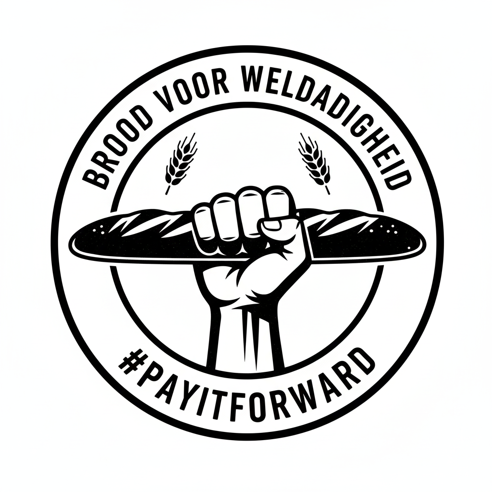
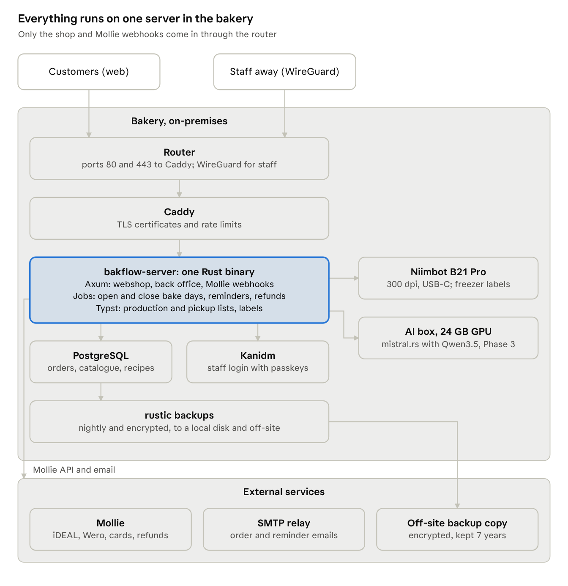
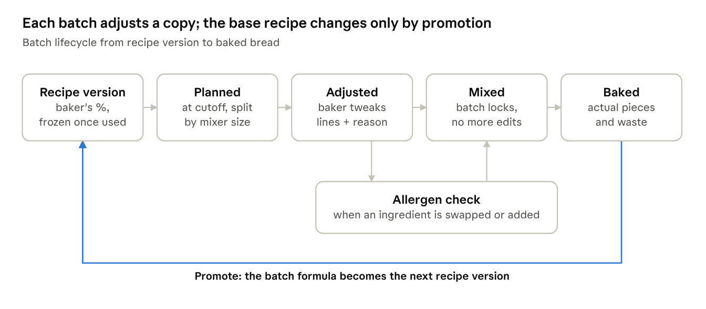
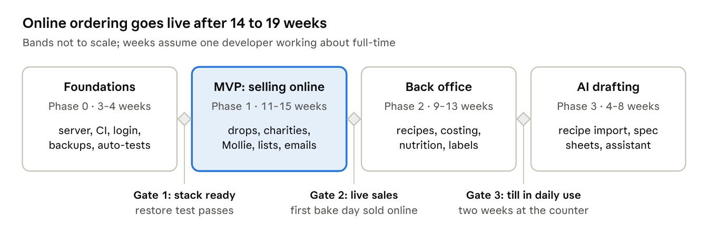

# Brood voor Weldadigheid — Specification v2 (Rust, self-hosted)

Nov 23, 2026 · @Rob Vermaas



## Scope and changes from v1

v2 covers ordering, production, recipes and labels for a pickup-only microbakery. It is written in Rust, with no Python anywhere in the running stack, and runs entirely on-premises in the bakery.

**In scope**

- Bake days with order cutoffs, a maximum per product and configurable pickup windows

- Webshop with Mollie payments (iDEAL and Wero, cards) and a sick-day cancel with automatic refunds

- Order management, production list and pickup list

- Product catalogue with allergens and ingredient text

- Versioned recipes in baker's percentages, per-batch adjustments, ingredient needs per bake day and costing

- Product labels and freezer labels for frozen batches, made as files the bakery prints on its Niimbot printer with the official Niimbot app

- Sales report per BTW rate, exported for the accountant, and an overview of business orders to invoice by hand

- AI drafting: recipe import, allergen extraction from supplier spec sheets, product texts and a Dutch customer assistant

- Donations: what customers pay for a drop is earmarked for that drop's charity, which the bakery transfers itself; customers can pick another charity or save their donation for later

- A public drop calendar, FAQ, contact page, drop alerts by email and a bread vote

- Served at https://broodvoorweldadigheid.nl/, replacing the current Payhip shop

**Removed in v2**

| Removed | Also dropped as a result |
|----|----|
| SKAL organic traceability | Ingredient lot tracking, mass balance |
| Accounting and invoicing (for now) | Dunning, bank matching, purchase-invoice reading, Peppol e-invoicing (business orders on account stay, invoiced by hand) |
| Packing and delivery | Delivery addresses, packing slips |
| Route planning | VRP solver, OSRM |
| Sales forecasting | Suggested bake quantities, energy-aware bake planning |
| HACCP logging | Temperature sensors, cleaning logs |
| Subscriptions | Mollie mandates, recurring direct debit |
| Till (for now) | Tap to Pay, till web app, offline sync; counter, market, frozen and packaged sales go through the bakery's own SumUp app |

The sales report stays because the accountant needs webshop totals per BTW rate. It is an export, not bookkeeping; counter, market and frozen sales come from SumUp's own reports.

## Functional requirements

The MVP gets the bakery selling online. Phase 2 moves recipes and labels into the system. Phase 3 adds AI drafting.

| ID | Feature | Must do | Phase |
|----|----|----|----|
| F1 | Bake-day calendar | Create, copy and repeat bake days; product range per day; every bake day (drop) has its own order deadline, filled in from a default rule and changeable per drop; ordering opens and closes automatically at the set times; baking starts at 05:00 on the bake date, set by the system; a warning when a deadline is later than the sourdough allows (20:00 two days before the bake date); countdown in the shop; pickup day and window filled in from the location's default and changeable per bake day; a bake day can also be production-only, without online ordering | MVP |
| F1a | Drop calendar | Plan drops weeks ahead and show them on a public page: date, pickup window, location, the drop's charity or a clear “normal sale” label, and status (planned, menu announced, open until the deadline, sold out, closed). The menu can follow later and is published automatically at a set time, for example Wednesday. An iCal feed lets customers add drops to their own calendar | MVP |
| F2 | Sick-day cancel | Owner only. One action closes the day, emails every customer the baker's message and refunds through Mollie | MVP |
| F3 | Capacity limits | A maximum per product per bake day; stock shown live; no overselling when two customers check out at once | MVP |
| F4 | Webshop | Dutch UI, photos, allergen icons, ingredient text, pickup location and time slot, guest checkout | MVP |
| F4a | Pickup locations | Locations with address and default pickup windows (weekday, start and end time), all editable; starts with De Proef, Majoor van Swietenlaan 15, 8382 CE Frederiksoord, Saturday 11:00–12:00 | MVP |
| F4b | Pay what you want | For chosen products the customer sets their own price (their donation on charity drops), with the field prefilled at a suggested amount; the baker sets the suggestion, a minimum and a maximum per product; the server checks the amount, never the browser; business accounts ordering on account pay the suggested price | MVP |
| F4c | Charity per drop | Each drop has a charity with name, short description and link, shown on the drop page and at checkout, and what customers pay for that drop's bread is earmarked for it. A drop can also have no charity, for a normal sale: the shop then shows no donation text, nothing is earmarked and the money is regular revenue | MVP |
| F4d | Choose another charity | On drops with a charity, the customer can at checkout move their donation to another charity from the bakery's list, or save it for a later charity. A saved donation comes with a link to choose later, and goes to the next drop's charity if no choice is made within a set period (default 3 months), which the customer is told up front | MVP |
| F4e | FAQ | Questions and answers edited in the back office, shown on the site and used by the customer assistant (F23); starts from the four questions on the current site, rewritten for paying through the shop | MVP |
| F4f | Contact | Contact form that emails the bakery, with spam protection | MVP |
| F4g | Charity management | Add, edit and archive charities in the back office: name, short description, logo, website, bank details for transfers and ANBI number. Only active charities can be chosen by customers; archived charities stay in the history | MVP |
| F5 | Online payment | iDEAL and Wero, cards and Bancontact through Mollie's hosted checkout; status from webhooks | MVP |
| F6 | Order management | Order list per bake day; edit, cancel and refund; customer notes; audit log | MVP |
| F7 | Production list | Totals per product per bake day, orders plus extra production, on screen and as PDF | MVP |
| F7a | Extra production | Add or change pieces per product on any bake day on top of orders, with a purpose (freezer, SumUp sales, samples, other); extras count against capacity so the webshop does not oversell; changeable until the batch is mixed | MVP |
| F8 | Pickup list | Orders per customer and time slot; tick off on a phone at pickup | MVP |
| F9 | Emails | Order confirmation, pickup reminder, cancellation; Dutch templates | MVP |
| F9a | Drop alerts | Opt-in email list with confirmation by email; people sign up on the site; subscribers hear when a drop's menu is published or ordering opens; one-click unsubscribe | MVP |
| F9b | Bread vote | The baker lists candidate breads, optionally for a specific drop; visitors vote once per confirmed email address, with an optional wish of their own; results visible to the baker and optionally on the site; the vote closes on a set date | Phase 2 |
| F10 | Product catalogue | 14 allergens, ingredient text, price incl. BTW, BTW rate 9% or 21%; per product whether it is sold online or only outside the system (frozen and packaged products are sold through the bakery's SumUp app). May-contain (“kan sporen bevatten van”) is one kitchen-wide list in the company settings, not per product: allergens used in the kitchen but not in every recipe (owner, 2026-11-25). Every product shows its own allergens plus that list minus what it already contains; the list has its own approval | MVP |
| F11 | Sales report | Sales per BTW rate per day, month and quarter; CSV export; for pay-what-you-want products, the average price paid against the suggested price | MVP |
| F11a | B2B invoice overview | Business customers (company name, KvK, BTW-id, invoice address and email) order on account in the shop or through staff. An overview per customer and period lists every uninvoiced order with prices excl. BTW and totals per BTW rate, as screen, PDF and CSV. Marking orders invoiced records the invoice number and date from the hand-made invoice, so nothing is billed twice or missed | MVP |
| F11b | Charity payout overview | Per charity and period: donations received, refunds, and the amount to transfer, which is the full amount customers paid minus refunds, with nothing taken off for BTW, fees or costs; saved donations shown separately. Marking a transfer records date, amount and bank reference | MVP |
| F11c | Donation reports | For admins. Per charity drop: total donated, number of orders, and the split between the drop's charity, other chosen charities and saved donations. Per charity: totals per period and all-time, with transferred against still to transfer. Charts and CSV export | MVP |
| F11d | Public donation page | Totals per drop and per charity on the site, switched on when you are ready; never shows names or individual amounts | Phase 2 |
| F11e | Your contribution | For admins. Per drop and per charity, the costs the bakery covers so the charity gets the full amount: BTW owed on the donations, Mollie fees, ingredient cost and other costs entered per drop (packaging, energy). Shows the total and what it means per euro donated, for example “for every €1 the charity received, you covered €0.38”. Ingredient cost uses a per-product estimate until costing (F16) ships, then the actual batch cost | MVP |
| F12 | Privacy tools | Export and delete a customer's data; marketing consent | MVP |
| F13 | Staff roles | Owner, baker and counter roles; passkey login; owner and baker can refund an order, only the owner can cancel a whole bake day | MVP |
| F14 | Recipe versions | Base recipes in baker's percentages with sub-recipes, preferments and hydration; a version freezes once a batch uses it, and editing creates the next version | Phase 2 |
| F14a | Batches | The baker starts each batch by hand for any quantity; each batch copies the recipe version; the baker adjusts lines and quantities with an optional reason; grams recalculate live; a batch locks when mixed; actual pieces and waste are recorded after baking | Phase 2 |
| F14b | Promote an adjustment | Save a batch formula as the next recipe version in one action | Phase 2 |
| F15 | Ingredient needs | Ingredient totals per bake day as a shopping list, including extra production: from recipe versions before cutoff, from batch lines after | Phase 2 |
| F16 | Costing | Standard cost per product, actual cost per batch, and the variance split into recipe, price and yield; ingredient prices with a valid-from date | Phase 2 |
| F17 | Allergen roll-up | Allergens and ingredient text computed from the recipe and approved by the baker; a batch that swaps or adds an ingredient is re-checked and cannot be labelled until any difference is approved | Phase 2 |
| F17a | Nutrition values | Dropped (owner, 2026-11-25): labels carry no nutrition table, because the bakery uses the small-producer exemption | — |
| F18 | Product labels | Full labels for packaged products such as cookies and granola, printed on the Niimbot through the official Niimbot app: name, ingredients with allergens in bold, net weight, best-before date, storage instruction, batch code, business name and address (no nutrition table: small-producer exemption); a longer label, or a front and back label, when it does not fit; warning when a batch changes the ingredient order by weight | Phase 2 |
| F18a | Freezer labels | After baking, enter how many pieces of a batch go into the freezer and print one label each through the Niimbot app. The label goes to the customer, so it carries product name, ingredients with allergens in bold, net weight, best-before date from a per-product freezer period, storage instruction, and business name and address; plus freeze date, batch code and a small QR code for staff. Default label size 50 × 30 mm; a long ingredient list moves to a longer label (the B21 Pro takes up to 170 mm) | Phase 2 |
| F20 | Recipe import | Photo or Excel to a draft recipe the baker checks | Phase 3 |
| F21 | Spec-sheet reading | Supplier spec sheet to draft allergens and ingredients for approval | Phase 3 |
| F22 | Product texts | Draft shop descriptions in the bakery's tone | Phase 3 |
| F23 | Customer assistant | Dutch chat in the shop about products, allergens, pickup, charities and order status | Phase 3 |

Until F17 ships, allergens and ingredient text are entered by hand per product (F10).

## Compliance that still applies

Removing modules does not remove the legal duties behind them. Bookkeeping, B2B invoices and HACCP records must now be handled outside the system.

| Rule | What the system must do |
|----|----|
| BTW: 9% for bread and pastry, 21% for non-food and alcohol | BTW rate per product; rate and BTW amount on order confirmations and receipts; totals per rate per period |
| Retention: business records 7 years | Keep orders and payments for 7 years, in the database and in backups |
| Allergens (EU 1169/2011): 14 allergens | Allergen information for every product in the shop and on shelf cards; allergens in bold in ingredient lists on labels |
| Prepacked products (cookies, granola) | Full label: name, ingredients with allergens in bold, net quantity, best-before date, storage instruction, batch code, business name and address. No nutrition table: the bakery sells directly to consumers and local shops and uses the small-producer exemption (owner, 2026-11-25). Fresh bread sold unpacked only needs allergen information on hand |
| GDPR (AVG) | Marketing consent, export and deletion of customer data, a processing register, processor agreements with Mollie and the email relay |
| KvK and contact details | KvK number, trade name and address on the website, in emails and on receipts |
| Payments: iDEAL moves to Wero, completion planned by 31 Dec 2027 | Take payment methods from Mollie's method list; never hard-code iDEAL |
| Dutch language | Dutch UI, emails and labels; Dutch number and date formats (1.234,56 and dd-mm-jjjj) |
| Frozen bread sold frozen (EU 1169/2011) | The freezer label is the customer's label: name, ingredients with allergens in bold, net weight, best-before date, a storage instruction such as “bewaren in de vriezer bij −18 °C”, and business name and address. “Ontdooid” is not needed, because nothing is sold thawed. Check with NBC or NVWA whether bags you pack yourself count as prepacked or packed for direct sale, as that sets what the label must carry |
| Collecting donations to forward to charities | Ask the accountant before launch: money paid for bread is likely turnover with 9% BTW even when it is called a donation, forwarding the full amount is then the bakery's own gift, so BTW, fees and ingredients come out of the bakery's pocket (shown in F11e), and customers cannot deduct it. Tell Mollie about the donation model when signing up. Be open on the site about how the money is forwarded; the payout overview (F11b) keeps the records |

**Now handled outside the system**

- Bookkeeping and the BTW return: the accountant, fed by the CSV sales export.

- B2B invoices: Dutch VAT law requires an invoice when you sell to a business. Until invoicing returns, invoices are made by hand from the B2B invoice overview (F11a). Those invoices still need consecutive numbers and all legally required details.

- HACCP: work by the Hygiënecode voor de Brood- en Banketbakkerij on paper or with a separate tool.

Sources: [Belastingdienst on retention](https://www.belastingdienst.nl/wps/wcm/connect/bldcontentnl/belastingdienst/zakelijk/btw/administratie_bijhouden/administratie_bewaren/), [BTW rate for bread](https://hoeveelbtw.nl/tarief/brood), [NBC on hygiene for a new bakery](https://www.nbc.nl/kennis-regelgeving/het-starten-van-een-eigen-bakkerijwinkel). The Wero date is from the EPI press release of July 2026.

## Architecture

v2 runs on one server in the bakery: a single Rust binary plus PostgreSQL, Kanidm and backups. The optional AI box sits on the same local network. Labels print on the Niimbot printer from the official Niimbot app, using files the system makes.



system architecture · on-premises server, bakery devices, external services

The router forwards only ports 80 and 443 to Caddy; staff reach the back office from outside through WireGuard. Mollie, the email relay and an off-site backup copy are the only things outside the bakery that the running system uses. GitHub and Cachix hold only the public code and its build output, never customer data or secrets.

**Why one binary**

- HTTP, background jobs and PDF generation run in one process, so there is no message broker or separate worker to operate.

- Business areas stay separate as crates in the workspace (see Cargo workspace layout), which gives clear boundaries without the running cost of microservices.

- Rust's low memory use keeps the VPS small and cheap.

**On-premises set-up**

- One always-on small server with two mirrored SSDs, on a UPS.

- A fixed IP address from the internet provider, or dynamic DNS with inadyn if the address changes.

- The server on its own network segment, apart from guest Wi-Fi.

- If the bakery's internet or power fails, the shop is offline until it returns (see Risks).

- The site is served at https://broodvoorweldadigheid.nl/, and Caddy gets its certificate for that domain automatically. Go-live moves the domain's DNS from Payhip to the bakery's IP address. Old Payhip links are not redirected.

## Technology stack

Everything we write is Rust. The few services we run but do not write are C, C++ or Go, so no Python runs anywhere.

| Layer | Choice (alternative) | Language |
|----|----|----|
| Web server | Axum on Tokio (Actix Web) | Rust |
| Database | PostgreSQL | C |
| Database access, migrations | SQLx, queries checked at compile time (SeaORM) | Rust |
| Background jobs | apalis on PostgreSQL (a jobs table polled with SKIP LOCKED) | Rust |
| Pages for shop and back office | Askama templates + HTMX, server-rendered (Leptos) | Rust, one small JS file |
| Translations | Fluent (fluent-bundle), Dutch first | Rust |
| Money and dates | Integer cents with rust_decimal for maths; jiff with Europe/Amsterdam (chrono + chrono-tz) | Rust |
| Email | lettre over an SMTP relay | Rust |
| PDFs | Typst used as a library, also rendering label PNGs for the Niimbot app | Rust |
| Excel import | calamine | Rust |
| Payments | mollie-rs, or a small own client on reqwest | Rust |
| Staff login | Kanidm (OIDC, passkeys) with a small own client: ES256 ID tokens verified with ring (Rauthy) | Rust |
| Customer login | Email magic links, sessions via tower-sessions | Rust |
| AI serving | mistral.rs, OpenAI-compatible API (llama.cpp server) | Rust (C++) |
| Vector search | pgvector inside PostgreSQL (Qdrant) | C (Rust) |
| Reverse proxy, TLS | Caddy (Traefik) | Go |
| Backups | rustic (restic) | Rust (Go) |
| Monitoring | tracing logs, Prometheus and Grafana, Gatus health checks (plus one Gatus outside the bakery), ntfy alerts | Rust, Go |
| Code hosting, CI | GitHub, public repo rbvermaa/broodvoorweldadigheid; GitHub Actions on x86_64 runners with Nix; branch protection requires the ci-ok check; PRs merge by auto-merge once ci-ok passes (no merge queue on a personal-account repo) (Forgejo with Forgejo Actions) | Hosted |
| Deployment | Nix flake: crane builds the Rust binary, nix2container (or dockerTools) builds minimal OCI images, Docker Compose runs them | Nix |
| Label printer | The labels crate makes a PNG per label and a CSV of the label text; the official Niimbot app prints them | Rust |
| Dynamic DNS | inadyn, only if the bakery has no fixed IP address | C |
| Testing | cargo-nextest, proptest, insta, cargo-llvm-cov, cargo-mutants, thirtyfour (see Testing and quality) | Rust |
| Build cache | Cachix, the public Nix binary cache rbvermaa, so CI only rebuilds what changed (attic, self-hosted) | Hosted |

mistral.rs loads Hugging Face weights directly and quantises them on load, so no Python conversion step is needed for models either. [mollie-rs](https://docs.rs/mollie-rs) is an unofficial client maintained by Suits Finance B.V., generated from Mollie's OpenAPI spec.

**Builds with Nix.** One flake.nix defines everything that gets built, and flake.lock pins every input, so the same commit always produces the same artifacts:

- the developer shell (nix develop) with the exact Rust toolchain, PostgreSQL, Typst and test tools;

- the server binary, built with crane;

- the OCI images for the server and the AI box, containing only the binary, CA certificates, time-zone data and the label fonts, with no operating-system userland to patch;

- all checks (nix flake check): formatting, Clippy, cargo-deny, cargo-audit, the test suite and coverage.

Because fonts and libraries are pinned too, PDFs and label images render identically on a laptop, in CI and in production, which keeps the snapshot tests stable. Rolling back means starting the previous image. NixOS for the server itself is an option for later, but not required.

The system has no own Niimbot driver. The printer protocol is reverse-engineered, and the authors of the open-source drivers ask that they are not used commercially without Niimbot's consent. The bakery's printer is a NIIMBOT B21 Pro: [300 dpi with a 50 mm print head of 591 pixels](https://printers.niim.blue/hardware/niimbot-b21_pro), so labels render at about 11.8 pixels per mm. Typst draws each label, and the system offers it as a 300-dpi PNG at its exact size with a copy count, plus CSV rows of the label text for the Niimbot app's import. The owner prints them with the official Niimbot app. The exact import format is checked against the app when Phase 2 builds this.

## Cargo workspace layout

One repository and one Cargo workspace: a small library crate per business area, two binaries plus a CLI, and dependencies that only point downward so the compiler enforces the design.

``` text
bakflow/
├── flake.nix             pinned toolchain, dev shell, builds, OCI images, checks
├── flake.lock            exact versions of every build input
├── nix/                  image, check and NixOS VM test definitions
├── Cargo.toml            workspace, shared dependency versions
├── crates/
│   ├── domain/           pure types: Money, VatRate, Allergen, ids, errors, PaymentProvider trait; no I/O
│   ├── db/               SQLx pool, migrations/, test fixtures
│   ├── i18n/             Fluent bundles, Dutch number and date formatting
│   ├── auth/             staff OIDC login, customer magic links, roles
│   ├── catalog/          products, prices, BTW rates, allergens, ingredient text
│   ├── bakedays/         bake days, cutoffs, pickup slots, per-product limits, sick-day cancel
│   ├── orders/           cart, checkout, capacity holds, order status, audit log
│   ├── payments/         Mollie implementation of PaymentProvider, webhooks, refunds
│   ├── production/       production list, pickup list; batches: adjustments, actuals, actual cost (Phase 2)
│   ├── reports/          sales per BTW rate, B2B invoice overview, CSV export
│   ├── notify/           email templates and sending
│   ├── jobs/             scheduled work: open and close bake days, reminders, cleanup
│   ├── recipes/          versioned recipes, sub-recipes, scaling, ingredient needs, standard cost, allergen roll-up                 (Phase 2)
│   ├── labels/           Typst label templates, freezer labels, PNG and CSV files for the Niimbot app                       (Phase 2)
│   ├── pos-core/         reserved for a later till; not built in v2
│   ├── testkit/          fixtures, fake Mollie, fake clock (tests only)
│   └── ai/               LLM client, extraction schemas, assistant tools, behind feature "ai"       (Phase 3)
├── apps/
│   ├── server/           Axum binary: shop, back office, Mollie webhooks
│   ├── pos/              reserved for a later till web app; not built in v2
│   └── cli/              migrate, seed, import, export
├── e2e/                  browser tests for webshop and back office (thirtyfour)
├── locales/              nl/*.ftl, en/*.ftl
├── design/               tokens.toml, component gallery, icons
├── templates/            Askama HTML templates
├── typst/                production list, pickup list, labels
└── deploy/               compose.yaml using the Nix-built images, Caddyfile, Kanidm and backup config
```

**Dependency rules**

1.  A crate may only depend on crates in a lower layer:

    1.  Layer 0: domain

    2.  Layer 1: db, i18n, pos-core

    3.  Layer 2: auth, catalog

    4.  Layer 3: bakedays, recipes

    5.  Layer 4: orders, labels

    6.  Layer 5: payments, production, notify, ai

    7.  Layer 6: reports, jobs

    8.  Layer 7: everything under apps/; apps may use every library crate, but not each other

2.  production owns batches: it reads recipe versions from recipes and order totals from orders, and computes actual cost. reports sits above it to show variances.

3.  orders starts payments through the PaymentProvider trait in domain; payments implements it and the server wires them together.

4.  pos-core depends on domain only; it is reserved for a later till and not built in v2.

5.  Only apps/server knows HTTP. Crates return domain types and typed errors, never HTTP responses.

6.  ai sits behind a Cargo feature; the server builds and runs without it.

7.  CI checks the layers with cargo metadata and runs cargo deny for licences and known vulnerabilities, so the rules cannot drift.

## Data model

Thirty-eight tables cover v2. Customers need no address because everything is picked up; recipes are versioned and every batch keeps its own formula.

``` text
Company          name, kvk, btw_id, address, settings, may_contain[],
                 may_contain_approved_by?, may_contain_approved_at?
StaffUser        oidc_sub, name, role (owner | baker | counter)
Customer         email, name, phone, marketing_consent, created_at
BusinessAccount  customer_id, company_name, kvk, btw_id, invoice_address, invoice_email,
                 on_account_allowed
PickupLocation   name, address, notes
PickupWindow     location_id, weekday, starts, ends, default_deadline_days_before,
                 default_deadline_time, active

Product          name_nl, description_nl, photo, price_incl_cents, vat_rate (9 | 21),
                 pay_what_you_want, min_price_cents?, max_price_cents?,
                 unit_weight_g, dough_g_per_piece, freezer_days?, recipe_id?, allergens[],
                 ingredient_text, allergens_approved_by?, allergens_approved_at?, packaged,
                 sold_online, estimated_cost_cents?, active
Ingredient       name, supplier_name, allergens[], may_contain[], spec_sheet_document_id?
IngredientPrice  ingredient_id, price_per_kg_cents, valid_from
Recipe           name, kind (dough | filling | topping), current_version_id
RecipeVersion    recipe_id, version, frozen_at?, promoted_from_batch_id?, bake_loss_pct, lead_time_hours, notes,
                 method_kind (none | text | steps), method_text
RecipeLine       recipe_version_id, ingredient_id | sub_recipe_id, bakers_pct
RecipeStep       recipe_version_id, position, name, duration_min?, temperature_c?, notes

BakeDay          date, online_ordering, charity_id?, menu_publish_at?, opens_at?,
                 cutoff_at?, bake_starts_at (05:00 on date, set by the system),
                 status (draft | open | closed | cancelled | done),
                 cancel_message?
PickupSlot       bake_day_id, location_id, starts_at, ends_at, max_orders?
BakeDayProduct   bake_day_id, product_id, max_qty?
ProductionExtra  bake_day_id, product_id, qty, purpose (freezer | sumup | samples | other), note?

Batch            bake_day_id, recipe_version_id, mix_no, flour_g,
                 status (planned | adjusted | mixed | baked), allergens[],
                 allergens_approved_by?, notes
BatchLine        batch_id, ingredient_id | sub_recipe_id, base_pct?, actual_pct, reason?
BatchOutput      batch_id, product_id, planned_pieces, actual_pieces, waste_pieces, frozen_pieces
LabelPrint       batch_id?, product_id, kind (product | freezer), copies, printed_at

Order            number, customer_id, bake_day_id, pickup_slot_id, channel (web | manual),
                 payment_mode (online | on_account),
                 status (pending_payment | paid | confirmed | picked_up | cancelled | refunded),
                 total_cents, hold_expires_at, manual_invoice_id?, created_at
OrderLine        order_id, product_id, qty, unit_price_cents, suggested_price_cents?, vat_rate
Payment          order_id, provider_payment_id, method, amount_cents, fee_cents?, status, refunded_cents
Refund           payment_id, amount_cents, refunded_before_cents, status (requested | done | failed),
                 provider_refund_id?, attempts, last_error?, requested_by, requested_at
ManualInvoice    customer_id, invoice_number, invoice_date, period_from, period_to, total_cents

Charity          name, description, url, logo?, iban?, anbi_rsin?, archived_at?
DropCost         bake_day_id, kind (packaging | energy | other), amount_cents, note?
DonationAllocation  order_id, charity_id?, amount_cents,
                 status (earmarked | saved | transferred), choose_token_hash?, choose_by?
CharityTransfer  charity_id, amount_cents, transferred_at, bank_reference

Subscriber       email, confirmed_at?, unsubscribed_at?
FaqEntry         question, answer_md, position, published
Poll             title, bake_day_id?, closes_at, public_results
PollOption       poll_id, product_id?, name
Vote             poll_id, poll_option_id, email, wish?, confirmed_at?, created_at

Document         path, mime, sha256, uploaded_by, uploaded_at
AiTask           kind, input_document_id, output_json, model, status (draft | confirmed | rejected),
                 confirmed_by?
AuditLog         entity, entity_id, action, before, after, actor, at
```

**Rules the code enforces**

- Money is stored as integer cents with an explicit VatRate; totals per rate are computed from lines, never typed in.

- Order lines copy price and BTW rate at the moment of sale, so later price changes do not alter history.

- Checkout reserves capacity inside one transaction that locks the bake day's product rows (BakeDayProduct, in product order). An unpaid order holds its capacity until hold_expires_at (default 15 minutes), then a job releases it.

- Paid orders and payments are never edited in place: changes are new rows plus an audit-log entry. A refund is its own Refund row and is never deleted; a failed refund is retried on the same row.

- A recipe version freezes when the first batch uses it; any edit after that creates a new version.

- A batch locks when it is marked mixed; its lines never change after that.

- Batch cost uses the ingredient price valid on the bake day, so old batches keep their old prices.

- A product's allergen data is published only after approval. Changing its recipe or an ingredient's allergens clears the approval.

- The kitchen-wide may-contain list is published only after its own approval, and any change clears it. A product can be shown with allergens, ordered or labelled only while both its own allergen data and the kitchen-wide list are approved.

- A batch that swaps or adds an ingredient gets its own allergen roll-up. If it differs from the product's approved allergens, its labels are blocked until someone approves it.

- Counter, market, frozen and packaged sales go through the bakery's SumUp app and are not recorded in the system.

- A new bake day takes its pickup date and time from the location's default window; staff can change both per bake day. The first location is seeded as De Proef, Saturday 11:00–12:00.

- A freezer label's best-before date is the freeze date plus the product's freezer_days; products without a freezer period cannot get freezer labels.

- Only business accounts with on_account_allowed can order on account; those orders skip Mollie and are confirmed straight away.

- An on-account order stays in the invoice overview until it is linked to a ManualInvoice. After that it cannot be edited; corrections are new orders, so the overview always matches what was invoiced.

- Products with sold_online off, such as frozen bread, cookies and granola, never appear in the webshop; they are sold through the bakery's SumUp app, without a stock check.

- Extra production takes capacity like an order, so the webshop only offers what is left. A production-only bake day never opens in the webshop.

- Baking starts at 05:00 Europe/Amsterdam on the bake date. The system sets bake_starts_at; staff do not enter it. A deadline is never after it.

- Every drop has its own deadline (cutoff_at), filled in from the pickup window's default, for example Thursday 20:00 for a Saturday pickup, and changeable per drop. The sourdough needs orders by 20:00 two days before the bake date (a bakery setting); the back office warns only when a deadline is later than that. Products and recipes add no warnings of their own.

- An order counts if checkout started before the deadline and payment completes within its 15-minute hold. After the deadline only staff can add orders, still within capacity.

- For pay-what-you-want products, price_incl_cents is the suggested price. The server refuses any chosen price outside min_price_cents and max_price_cents, and the order line keeps both the chosen and the suggested price. The chosen price includes BTW at the product's rate.

- Every paid order creates a donation allocation for the drop's charity, or for the charity the customer chose. A saved allocation keeps a link token; if no charity is chosen by choose_by, a job moves it to the next drop's charity and emails the customer.

- A charity transfer covers the allocations earmarked for that charity. Once linked to a transfer they cannot change; a refund after that appears as a correction in the next payout. A refund counts against the payout as soon as it is requested, also while it is still waiting or has failed, so a charity never gets money that goes back to a customer.

- A vote counts once per confirmed email address per poll. Drop alerts go only to confirmed subscribers, and every email has a one-click unsubscribe.

- Charities are archived, never deleted, so past drops and totals always keep their charity. Donation reports are computed from the allocations, so a drop's total and a charity's total always add up to the same money; the public page shows totals only, never names or single amounts.

- Charities receive the full amount paid minus refunds. BTW, Mollie fees (read per payment from Mollie's balance reports), ingredients and other drop costs are the bakery's own contribution, reported per drop and per charity in F11e.

- A drop without a charity is a normal sale: no donation allocations are created and the revenue stays with the bakery. The donation and contribution reports skip it; the sales report includes it like any other sale.

- A drop's charity, or the choice of no charity, can change only until the first order comes in, so customers always know where their money goes.

## Recipe versions and batches

Base recipes are frozen templates; each batch copies its recipe version and the baker adjusts that copy. Planning and pricing stay stable, and every batch records what really went into the dough.



batch lifecycle · 5 states, allergen check, promote loop

The baker starts each batch by hand for any quantity, for example bread for the freezer on a day without online sales. There is no automatic split: the baker manages mixer capacity. The batches page shows the pieces (orders plus extra production) not yet in a batch. The baker adjusts a batch, for example water 78% to 74% or a different flour; grams recalculate live and changed lines show against the base. A batch locks once mixed, and after baking the baker records actual pieces and waste.

**Planning**

- Before cutoff, ingredient needs come from recipe versions; small tweaks barely move the totals.

- After cutoff, they come from the batch lines.

- Each flour is its own ingredient ("Tarwebloem, molen X" and "molen Y"), with its own price and allergens, so no lot tracking is needed.

- Each recipe version can record a lead time, for example 36 hours from levain build to bake, as information for the baker. It does not drive deadline warnings: the sourdough rule (20:00 two days before the bake date) does, so the levain is always built from final order numbers.

**Cost**

| Figure | How it is calculated | Used for |
|----|----|----|
| Standard cost | Recipe version × current ingredient prices, per piece of dough | Setting prices |
| Actual cost | Batch lines × prices valid on the bake day ÷ good pieces (baked minus waste) | Real margins per bake day |
| Variance | Actual minus standard, split into recipe changes, price changes and yield | Seeing why a margin moved |

**Allergens and labels**

- Changing quantities is always allowed.

- Swapping or adding an ingredient recomputes the batch's allergens. If they differ from the product's approved allergens, labels for that batch are blocked until someone approves.

- If an adjustment changes the ingredient order by weight, the system warns before printing.

Two things the design avoids: editing a base recipe in place, which loses history and breaks costs, and saving every batch as a new recipe, which floods the recipe list.

## AI features

AI only drafts; a person confirms every result before it reaches a product, a label or a customer. With forecasting gone, all four uses run on one mistral.rs server and one GPU.

| Use | How it works | Who confirms |
|----|----|----|
| Recipe import | Photo or Excel to a draft recipe; baker's percentages and scaling are computed in Rust, never by the model | Baker |
| Spec-sheet reading | Supplier PDF or photo to draft allergens, may-contain and ingredients, shown as a diff against the current ingredient | Baker; never published automatically |
| Product texts | Draft shop descriptions in the bakery's tone | Owner |
| Customer assistant | Answers in Dutch about products, allergens and pickup from catalogue data; looks up order status; can fill a cart but never pays | Customer, at checkout |

**Models and serving**

- [mistral.rs](https://docs.rs/crate/mistralrs-cli/latest/source/README.md) supports the Qwen 3.5 family including vision, plus Qwen 3 Embedding for search. One server covers documents, chat and embeddings.

- Start with a quantised Qwen3.5-35B-A3B or Qwen3.5-27B on a 24 GB GPU. Smaller Qwen3.5 sizes (9B, 4B) run on less hardware for text drafting only.

- [Qwen3.6-27B and Qwen3.6-35B-A3B](https://docs.nvidia.com/nim/vision-language-models/2.0.11-variant/models.html) are newer; check mistral.rs support before switching.

- Gemma 4 was not in the mistral.rs support list. If you prefer it, run it on llama.cpp server, which offers the same OpenAI-style API.

**How the ai crate works**

1.  Calls the OpenAI-compatible HTTP API with reqwest, so the model server can be swapped without code changes.

2.  Asks for JSON and parses it into serde structs; invalid output is retried once, then handed to a person.

3.  Stores every prompt, output and model name in AiTask for audit.

4.  Sends the model only the document or question at hand, never the customer list.

**Hardware**

A dedicated box with one 24 GB GPU (a used RTX 3090 or RTX 4090) or a 32 GB RTX 5090 is enough. It is needed only from Phase 3 and can stay switched off until then.

## External integrations

Mollie, an email relay and an off-site backup copy are the only things outside the bakery; printers and the accountant hand-off stay local.

| Service | Used for | How |
|----|----|----|
| Mollie | Online payments (iDEAL and Wero, cards, Bancontact), sick-day refunds | REST API through mollie-rs or an own client. A webhook only carries a payment id, so the server fetches the payment from Mollie before changing an order. |
| SMTP relay | Order confirmations, pickup reminders, cancellations | lettre; SPF, DKIM and DMARC set on broodvoorweldadigheid.nl |
| Niimbot label printer | Freezer labels for frozen batches, product labels | Typst renders a 300-dpi PNG per label plus CSV rows of the text; the owner prints them with the official Niimbot app on the B21 Pro |
| Accountant | Sales per BTW rate | Monthly CSV download from the back office |

All Mollie calls sit behind the PaymentProvider trait, so a second provider can be added without touching orders.

**SumUp** stays outside the system: counter, market, frozen and packaged sales run through the bakery's own SumUp app, and their totals come from SumUp's reports. A till can be added later; Mollie's API-to-app flow already works with the bakery's iPhones.

## Security, backup and operations

Only the shop and the Mollie webhook face the internet; everything else needs a staff login or the WireGuard tunnel.

**Access**

- Staff log in through Kanidm with passkeys; roles limit who can refund, edit allergens or close a bake day. Owner and baker can refund an order; only the owner can cancel a whole bake day.

- Customers log in with email magic links, so no customer passwords are stored.

- Rate limits on login, checkout and the assistant (tower-governor).

- Secrets live in files encrypted with sops and age, never in the repository in plain text.

- The router forwards only ports 80 and 443; the server sits on its own network segment, apart from guest Wi-Fi.

**Code safety**

- \#\![forbid(unsafe_code)\] in every crate we write.

- SQLx only accepts parameterised queries checked at compile time, which rules out SQL injection in our code.

- cargo deny and cargo audit run in CI for vulnerable or wrongly licensed crates.

**Backups**

- Nightly pg_dump plus uploaded files, encrypted with rustic to a local disk and to an off-site copy, because a fire or theft would otherwise take the server and its backups together.

- Sales data kept for 7 years.

- Monthly restore drill into a staging copy.

**Monitoring and updates**

- /health endpoint checked by Gatus; alerts to a phone through ntfy.

- A short morning email to the owner: unpaid orders, failed webhooks, last backup.

- Weekly cargo update on a branch, merged automatically when all tests pass; deploys and rollbacks are automatic (see Testing and quality).

- Budget 2 to 4 hours a month of developer time; none of it needs the owner.

- A second Gatus outside the bakery (a home machine is enough) reports when the bakery's internet is down.

- The UPS signals a power cut so the server shuts down cleanly.

## Design system and UX

Every screen is built from one small set of design tokens and components, so the shop and back office look and behave the same everywhere. Automated checks enforce this, so consistency does not depend on anyone remembering the rules.

**Brand.** The bakery's logo, “Brood voor Weldadigheid \#payitforward” (top of this spec), is the brand mark. It is black on white, which suits every place it appears:

- the webshop header, with the fist-and-bread mark alone as the favicon and at small sizes;

- order emails and the production and pickup PDFs;

- product and freezer labels on the Niimbot, where a black-and-white logo prints sharply; on a 50 × 30 mm label it sits in a corner at about 12 mm.

The style is “Stempel”: ink #111111 on white, taken from the logo, with no accent colour. Headings use Oswald, a condensed bold sans with an open font licence close to the logo's lettering; body text uses Inter. Nix pins both fonts, and PDFs and labels embed them. The supplied 1024-pixel PNG is used everywhere; no SVG is needed.

**Design tokens.** Colours, type sizes, spacing, corner radius and shadows are defined once in design/tokens.toml and turned into CSS variables at build time. No other code may set a colour or size.

**Component library.** Askama macros cover every element: buttons, form fields, product tiles, allergen badges, prices, the pickup-window picker, tables, alerts, empty states and the confirmation dialog. Pages only combine components and never add their own styling.

**Component gallery.** A page on staging shows every component in every state: normal, disabled, error, empty and with long Dutch words. The visual tests take their screenshots from this page.

**UX rules**

- Mobile-first: the shop and the pickup and extra-production screens are designed for iPhone first; recipes and costing work on both a phone and a desktop (owner, 2026-11-25).

- One way to do each thing: forms check input as you type, with Dutch messages; destructive actions such as a sick-day cancel or a refund ask for confirmation and say exactly what will happen; every save shows the same short confirmation.

- Words: all text lives in the Fluent files, with a glossary (bakdag or drop, bestel-deadline, ophaalmoment, bestelling, batch), one tone (“je”, friendly and short) and Dutch formats for money, dates and times.

- One icon set: Lucide (ISC licence), plus one fixed set of 14 allergen icons.

- Accessible by default: WCAG 2.2 AA for contrast, labels, keyboard use and visible focus.

- Fast: server-rendered HTML with HTMX and one small JS file, so every page works on a slow mobile connection.

## Testing and quality

Testing runs itself: every change is tested, deployed and checked automatically, and you only hear about it when something needs a developer. Money, BTW, capacity, allergens and labels get the strictest tests, because mistakes there cost money or harm customers.

**What you do: nothing in normal operation.** You get one ntfy alert in plain Dutch when something needs a developer, and a short weekly email saying everything is green.

**Test layers**

| Layer | Tool | What it covers |
|----|----|----|
| Unit tests | cargo test, run with cargo-nextest | Domain rules: money and BTW rounding, baker's percentage scaling, allergen roll-up, best-before dates, cutoff times |
| Property tests | proptest | Rules that must always hold: totals per BTW rate equal the sum of the lines; capacity never goes below zero; a pay-what-you-want price outside its minimum and maximum is always refused; scaling a recipe up and down keeps the same grams within rounding |
| Database tests | \#\[sqlx::test\], a fresh PostgreSQL database per test | Queries, migrations, constraints, and two checkouts racing for the last loaf |
| HTTP tests | Axum routers called in-process with tower::ServiceExt | Checkout, Mollie webhooks, login and roles, invoice overview, extra production |
| Payment tests | A fake PaymentProvider in-process | Paid, failed, expired, refunded and duplicate webhooks; sick-day refunds |
| Contract tests | Nightly, against Mollie test mode | Catches changes in Mollie's API before they hit real orders |
| Snapshot tests | insta | Email texts, production and pickup lists, and label images compared with approved versions |
| Browser tests | thirtyfour (WebDriver), inside the NixOS VM test | Every main flow in the webshop and back office, in Firefox, Chromium and WebKit (the closest to Safari on iPhone that runs on Linux), at iPhone, laptop and desktop sizes; HTMX updates; Dutch error messages |
| Fuzz tests | cargo-fuzz, nightly | Webhook payloads, Excel recipe import and other input from outside |
| Mutation tests | cargo-mutants, weekly | Whether the tests actually catch bugs in domain, orders, recipes and labels |
| AI checks | A fixed set of 30–50 real Dutch recipes and spec sheets with expected output | Rerun automatically on every model change; a lower score blocks the switch |
| Visual tests | Screenshots of every page and of the component gallery, compared with approved images at a small tolerance (image-compare) | Broken layouts, overflowing Dutch words, unintended style changes |
| Accessibility tests | axe-core, run inside the browser tests | WCAG 2.2 AA: contrast, labels, keyboard use, focus order |
| Design-system checks | A small Rust test over templates and CSS | No inline styles; no colours, sizes or classes outside the tokens and components; no missing or unused Dutch texts |

**Built to be reliable, not flaky**

- No test touches the internet: Mollie, email and the clock are faked in a testkit crate. Only the nightly contract test calls Mollie's test mode.

- Each database test gets its own fresh PostgreSQL database; randomness is seeded and time is injected.

- cargo-nextest retries a failed test once and reports it as flaky. A flaky test counts as a bug to fix, not to ignore.

- Nix pins the toolchain, every library and the fonts, so a test that passes in CI passes the same way on a laptop and in production.

**Coverage targets**

Measured with cargo-llvm-cov: at least 80% of lines overall, and at least 95% in domain, orders, payments, recipes and labels; the build fails below these numbers. The weekly mutation run must catch at least 80% of mutants in those crates, which proves the tests check something real.

**Pipeline, fully automatic**

1.  On every push, nix flake check runs format, lint, security and licence checks and all unit, property, database, HTTP and snapshot tests in the pinned environment, plus the coverage gate.

2.  nix build produces the container images; a NixOS VM test boots them with PostgreSQL, Kanidm and Caddy and runs the browser tests against them.

3.  The images are pushed to the bakery server and deployed to staging; smoke tests run, including a test order through Mollie test mode.

4.  Production switches to the same images automatically, except during a deploy freeze: from order cutoff until the end of the pickup window on each bake day, taken from the bake-day calendar.

5.  Health checks run for 15 minutes after each deploy. If one fails, the previous images are restored automatically and you get an alert.

**Nightly and weekly, also automatic**

- Nightly: the full suite including fuzzing and the Mollie contract test, plus a restore of last night's backup into staging with migrations and smoke tests run against it.

- Weekly: dependency updates on a branch, merged automatically when everything passes (major version upgrades wait for a developer); mutation tests; security audit.

- Every 5 minutes in production: shop pages, login, the webhook endpoint, a database write check, backup age, disk space and certificate expiry.

**Rules that keep it safe**

- No merge without a green pipeline, enforced by GitHub branch protection (the required ci-ok check and auto-merge) rather than discipline.

- Every bug fix starts with a test that reproduces it.

- Database migrations only add or extend, and removals happen in a later release, so an automatic rollback never breaks the data.

- Time-dependent logic is tested around the Dutch summer and winter time changes.

- The same gates bind an AI coding assistant: it cannot merge code without tests that pass coverage and mutation checks.

Setting up this automation, including the Nix builds, adds about 60–100 hours to Phase 0. After that, tests are written with each feature, at roughly a fifth of each phase. Both are included in the roadmap.

## Roadmap and effort

Customers can order online after Phase 1, 14 to 19 weeks in. The full v2 scope takes about 27 to 40 weeks and 1,030 to 1,690 development hours.



roadmap · 4 phases, 3 gates

Each phase ends at a gate; the next phase starts only when its criterion is met.

| Phase | Delivers | Weeks | Dev hours | Other costs |
|----|----|----|----|----|
| 0 Foundations | Server, router and DNS set-up; workspace; Nix flake, image builds and build cache; CI with automatic tests, deploys and rollback; Compose, Caddy, Kanidm, PostgreSQL, backups, monitoring, Dutch translations | 3–4 | 110–190 | Small server with mirrored SSDs and a UPS, about €950–1,750 |
| 1 MVP | F1–F13 (with drop calendar, charity management and reports, FAQ, contact and drop alerts), design system, component gallery, and the move from Payhip | 11–15 | 475–755 | Mollie transaction fees |
| 2 Back office | F9b, F11d and F14–F18a (without F17a), including batches, product and freezer labels as files for the Niimbot app | 9–13 | 325–525 | Niimbot label rolls (printer already owned) |
| 3 AI drafting | F20–F23 and the mistral.rs setup | 4–8 | 120–220 | AI box with a 24 GB GPU, about €2,000–4,000 |

All figures are estimates, not quotes. Rust costs more per feature than v1's ERPNext plan because every screen is hand-built, but the removed modules roughly balance that out. Outsourced at €75–100 an hour, development would cost about €77,000–169,000.

## Risks and open questions

The biggest risks are legal (allergens, B2B invoices) and human (one builder), not technical.

| Risk | Impact | Mitigation |
|----|----|----|
| Wrong allergen data | Customer harm, NVWA findings | Computed from recipes, human approval, approval cleared on every change; check label rules with NBC or NVWA |
| Invoicing businesses by hand | Orders missed or billed twice | The invoice overview lists every uninvoiced business order; marking an invoice records its number and locks those orders |
| One builder, few Rust developers in the Netherlands | System stalls if the builder leaves | Runbooks, tests per crate, small crate boundaries, a second person trained |
| No ready-made admin screens in Rust | Every back-office screen is hand-built | Keep screens few and server-rendered with HTMX |
| Young crates (mollie-rs, model support in mistral.rs) | Breakage on upgrade | Mollie behind a trait; llama.cpp as fallback behind the same API |
| Shop runs on the bakery's internet and power | Orders and Mollie webhooks fail during an outage | UPS; mobile-data backup on the router if it supports it; order cutoffs well before the bake day; after an outage the server re-checks open payments with Mollie |
| Labels depend on the official Niimbot app | An app update can change its import or image limits | The system only makes plain PNG and CSV files; check the import when Phase 2 builds labels; the PNGs can also be printed as plain images |
| Labels come off in the freezer | Frozen bread without a readable date | Test a roll of Niimbot labels at freezer temperature before relying on it; stick labels on dry bags before freezing; switch to freezer-grade labels if they peel |

**Open questions**

- [x] Will you sell to shops or horeca? If so, when does invoicing come back?

Yes. Invoices are made by hand from the B2B invoice overview (F11a) until invoicing returns.

- [x] Which Niimbot model do you have? B1, B18 and B21 print labels up to about 48 mm wide; D11 and D110 labels are much narrower.

NIIMBOT B21 Pro: 300 dpi, labels 20–50 mm wide, USB-C and Bluetooth.

- [x] Card payments at the till: a Mollie terminal or tap-to-pay on a phone? Check which one Mollie's API can start from our own app.

Till skipped for now; counter, market and frozen sales go through the bakery's SumUp app.

- [x] Do you sell prepacked products that need a full label, or only fresh pre-orders and counter sales?

Mostly fresh pre-orders and counter sales; possibly packaged cookies and granola, which need full labels (F18).

- [ ] Does the bakery have a fixed IP address from its internet provider?

- [ ] Who can run the system if the builder is unavailable?

- [x] Is frozen bread sold after thawing? Then check the “ontdooid” rule with the NVWA, and set a freezer period per product.

No, frozen bread is only sold straight from the freezer, so “ontdooid” is not needed. The freezer label becomes the customer's label (see Compliance and F18a).

- [x] Get the logo as SVG, and choose one accent colour to go with its black and white.

No SVG needed: the PNG is used everywhere. No accent colour: the owner chose the style “Stempel”, ink on white.

- [x] Pickup time: the current FAQ says 11:00–13:00, the homepage says 11:00–12:00. Which is right? Answer: 11:00–12:00; staff can change the default window per location and the pickup time per bake day.

- [x] Who pays the Mollie fees: does the charity get the full amount, with the bakery covering fees, or the amount after fees?

The charity gets the full amount paid; the bakery covers BTW, fees and ingredients (F11e).

- [x] Export the subscriber list from Payhip, if Payhip allows it, so drop alerts can start with the people who already signed up.

No: there are no Payhip subscribers. Drop alerts start with sign-ups on the site.
